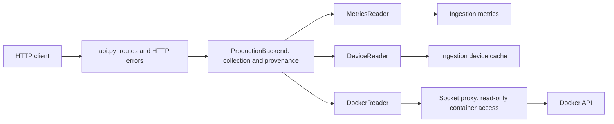

# EdgeOps Collector

`edgeops-collector` is the production-only telemetry middleware for EdgeOps AI. It reads live
Prometheus metrics and the ingestion device cache, inspects allowlisted Docker services, and serves
the stable collector read API on port `8095`.

Simulation is intentionally not part of this project. It lives in the independent sibling project
`edgeops-collector-simulation`. The production API does not register `/v1/simulation/*`.

## Architecture

The collector collects and normalizes telemetry. The AI service owns observation windows,
feature calculations, and predictions.



- `main.py` builds the application and owns resources for its lifespan. One HTTP client
  is shared by both ingestion readers and always closed on shutdown.
- `api.py` applies authentication to the `/v1` router, validates request parameters, and
  translates collector errors to HTTP responses. `/health` remains public.
- `backends/base.py` defines the small interface used by the API. `backends/production.py`
  coordinates readers and attaches capture metadata; it does not depend on application settings.
- `production/` contains upstream I/O and normalization. Docker lookup uses a sparse list
  followed by one inspection, including stopped containers and current health information.
- `schemas.py` defines the response contract and metric inventory; the metrics reader keeps
  upstream aliases, aggregation rules, and zero defaults explicit.
- `config.py` validates configuration, and `security.py` verifies the read key.

See [the refactoring record](docs/refactoring-2026-10-12.md) for the changes and validation.

## Local development

You need Python 3.12 or newer and `uv`.

```powershell
Copy-Item .env.example .env
uv sync --locked --dev
uv run uvicorn edgeops_collector.main:create_app --factory --host 0.0.0.0 --port 8095
```

Replace the example `COLLECTOR_API_KEY` before starting.

## Docker Compose

`compose.yaml` defines the `edgeops-collector` service and a Docker socket proxy. The collector
reads its settings from the untracked `.env` next to it and only exposes port `8095` on the Compose
network. Only the proxy mounts the Docker socket. It shares an internal-only `docker-api` network
with the collector and publishes no host ports.

The pinned [LinuxServer socket proxy](https://docs.linuxserver.io/images/docker-socket-proxy/)
allows container listing, inspection, and logs, plus version negotiation required by the Docker
SDK. Writes, events, and other API sections are disabled. The container smoke check verifies read
access without a collector socket mount and confirms that start requests and unrelated reads
receive HTTP `403`.

Standalone:

```powershell
Copy-Item .env.example .env
docker compose config --quiet
docker compose up -d --wait
docker compose exec -T edgeops-collector python - < scripts/container_contract.py
```

In the Server stack, the stack's `docker-compose.yaml` includes this file together with the
stack-side `edgeops-collector.override.yaml`:

```yaml
include:
  - path:
      - ./edgeops-ai/collector/compose.yaml
      - ./edgeops-collector.override.yaml
    env_file: ./.env
```

The override publishes `8095:8095` on the host. Remove the collector's old socket `volumes` and
`group_add` entries from existing overrides; otherwise they bypass the proxy. The collector no
longer needs `DOCKER_GID`. Other stack services reach it at `http://edgeops-collector:8095`.

## Authentication and routes

`GET /health` is public. Every `/v1/*` read route requires the production key in the
`X-EdgeOps-Key` HTTP header. The key is never accepted as a query parameter.

| Method | Path | Result |
| --- | --- | --- |
| `GET` | `/health` | Process health and version |
| `GET` | `/v1/meta` | Fixed production metadata |
| `GET` | `/v1/metrics/ingestion` | Canonical ingestion metrics |
| `GET` | `/v1/devices/{device_id}` | Live device-cache state |
| `GET` | `/v1/services` | Allowlisted service states |
| `GET` | `/v1/services/{service}` | One allowlisted service |
| `GET` | `/v1/services/{service}/logs` | Bounded, filtered logs |

Every data envelope has fixed provenance:

```json
{
  "metadata": {
    "captured_at": "2026-07-12T12:00:00Z",
    "collector_mode": "production",
    "simulated": false,
    "source_host": "rpi-smarthome"
  },
  "data": {}
}
```

The logs endpoint accepts `tail=1..500` and an optional case-insensitive `contains` filter of at
most 100 characters. Services remain fail-closed behind `COLLECTOR_ALLOWED_SERVICES`.

## Configuration

| Variable | Default | Description |
| --- | --- | --- |
| `COLLECTOR_API_KEY` | Required | Read-route API key |
| `COLLECTOR_SOURCE_HOST` | `rpi-smarthome` | Source metadata label |
| `COLLECTOR_INGESTION_METRICS_URL` | `http://ingest:9090/metrics` | Prometheus endpoint |
| `COLLECTOR_INGESTION_CACHE_URL` | `http://ingest:8085` | Device-cache base URL |
| `COLLECTOR_ALLOWED_SERVICES` | `emqx,ingest,influxdb,telegraf,grafana,device-management,control-ui,apple-homekit-api` | Docker service allowlist (Compose service names) |
| `COLLECTOR_HTTP_TIMEOUT_SECONDS` | `5` | Upstream timeout |
| `COLLECTOR_MAX_LOG_LINES` | `1000` | In-memory log bound |
| `DOCKER_HOST` | `tcp://docker-socket-proxy:2375` in Compose | Docker SDK endpoint; Compose sets it to the private socket proxy |

Unknown `COLLECTOR_` variables fail startup without exposing their values. Removed settings such as
`COLLECTOR_MODE` and every `COLLECTOR_SIMULATION_*` variable are rejected.

## Postman

Create variables `baseUrl=http://localhost:8095` and `readKey=<production key>`. Send, for example,
`GET {{baseUrl}}/v1/meta` with header `X-EdgeOps-Key: {{readKey}}`. Assert status `200`,
`mode === "production"`, and that `/v1/simulation/scenarios` returns `404`.

## Quality checks

```powershell
uv run ruff check .
uv run ruff format --check .
uv run pytest
```

## License

Released under the [MIT License](LICENSE).
